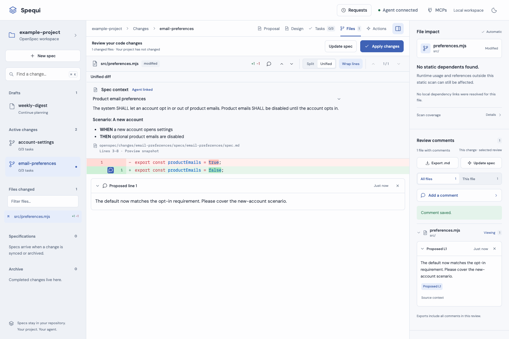

<div align="center">

# Spequi

**Understand the spec. Guide your agent. Review the implementation.**

Spequi brings [OpenSpec](https://openspec.dev/) documents, agent conversations, and code diffs into one local workspace.
Read the plan, give precise feedback, and review the implementation against requirements with the coding agent you already use.

[](https://www.npmjs.com/package/spequi)
[](https://nodejs.org/)
[](LICENSE)
[](docs/architecture.md)

</div>

<table>
  <tr>
    <td></td>
    <td></td>
  </tr>
  <tr>
    <td align="center"><sub>Plan beside your agent</sub></td>
    <td align="center"><sub>Review the diff against the spec</sub></td>
  </tr>
</table>

## Quickstart

```bash
cd /path/to/your-project      # a project that contains OpenSpec files
npx spequi@latest init        # sets up .spequi/ and registers the agent skill
```

Then invoke the Spequi skill **inside your coding agent**, with the same project open:

| Agent | Run after `init` |
| --- | --- |
| GigaCode CLI | `/skills spequi` or `/spequi` |
| Claude Code | `/spequi` |
| Codex | `$spequi` |
| Other skill-capable agents | load `.agents/skills/spequi/SKILL.md` |

The skill starts the local server, shares its URL, and handles requests from the UI. Open the URL it provides, normally **http://127.0.0.1:4310**. Keep the agent session running while you work. Reload your agent if the new skill does not appear.

> **Requirements:** Node.js 20+ and npm. For agent-driven work you also need the OpenSpec CLI and its workflow skills
> (current OpenSpec needs Node.js 22.12+). See [Getting started](docs/getting-started.md).

## Why Spequi?

Coding agents are fast. Reading what they changed, and checking it against what you *asked for*, is the slow part.
A plain diff shows **what** changed, not **why**.

- **Spec-linked diffs.** Linked code blocks show the requirement or scenario behind them, with source path and line range. Link coverage depends on the preview; suggested file-level context is labelled separately.
- **Review implementation before applying.** Implementation previews use an isolated copy. Applying is a separate, explicit step with conflict checks and backups. Planning requests update specification files in your project.
- **Bring your own agent.** GigaCode, Claude Code, Codex, or any skill-capable agent. No extra model endpoint or provider API key to configure.
- **Local workspace.** The UI binds to `127.0.0.1`. Browsing and offline analysis do not upload source. Your attached agent may send source to its provider; optional model generation sends selected context to your configured endpoint.

Spequi sends usage and failure analytics, including project folder names, Git user names when configured, and a persistent identifier shared across projects on the same machine account. Source files, prompts, and review comments are excluded. See [Security and limits](docs/security.md#analytics).

## How it works

1. **Plan.** Click **New spec**, describe an idea, and shape the plan beside your agent's conversation. Drafts save automatically.
2. **Preview.** Open **Implement** and request a preview. The agent builds in a separate copy of your project.
3. **Review.** Read Proposal, Design and Tasks, then inspect real diffs with available spec links, dependency impact, and inline comments.
4. **Apply.** Confirm explicitly. Spequi checks hashes and baseline conflicts, writes the files, and keeps recoverable backups. Then validate and archive.

## Features

- **Full lifecycle:** drafts, spec refinement, implementation preview, validate, archive
- **Unified and split diffs** with syntax highlighting, changed-word emphasis, folding and wrapping
- **Impact analysis:** direct and downstream dependencies, related tests, export changes
- **Precise feedback:** comments on files, code ranges and Markdown passages; export a review brief or queue a spec update
- **Requests inbox:** see questions, failures and running work across all specs
- **Works offline:** browsing, review, affected-file analysis and patch import need no agent
- **Light and dark themes**

## Documentation

| | |
| --- | --- |
| [Getting started](docs/getting-started.md) | Install, initialize, attach an agent, what `init` creates |
| [Planning workflow](docs/planning.md) | New specs, drafts, slash commands, planning stages |
| [Review workflow](docs/review.md) | Diffs, spec context, comments, requests inbox |
| [Offline tools and model preview](docs/offline-and-model.md) | Affected-file analysis, patch import, optional model endpoint |
| [Agent workflow](docs/agent-workflow.md) | Queue, heartbeat, questions, MCP reports |
| [Security and limits](docs/security.md) | Local data, boundaries, known limitations |
| [Architecture](docs/architecture.md) | Stack, repo layout, development, packaging |

## Status

Spequi is early. It is tested with Claude Code and Codex flows; continuous polling in a real GigaCode session and
native Windows execution are not yet verified. Static impact analysis can miss dynamic references and aliases.
See [Security and limits](docs/security.md) for the full list.

Feedback and bug reports are welcome in [Issues](https://github.com/rahulnjs/spequi/issues).

## Contributing

```bash
git clone https://github.com/rahulnjs/spequi.git
cd spequi
npm ci
npm run check
node bin/spequi.mjs init  --root /path/to/test-project
```

Open the test project in your coding agent and invoke the Spequi skill to start the workspace.

See [Architecture](docs/architecture.md) for the repo layout.

## License

[MIT](LICENSE)
