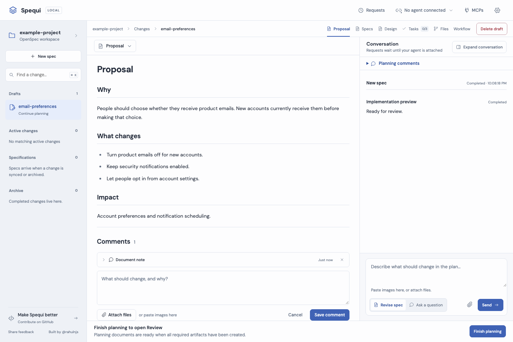

<div align="center">

# Spequi

**Understand the spec. Guide your agent. Review the implementation.**

Spequi brings [OpenSpec](https://openspec.dev/) documents, agent conversations, and code diffs into one local workspace.
Read the plan, give precise feedback, and review the implementation against requirements with the coding agent you already use.

[](https://www.npmjs.com/package/spequi)
[](https://nodejs.org/)
[](LICENSE)
[](docs/architecture.md)

</div>

<table>
  <tr>
    <td></td>
    <td></td>
  </tr>
  <tr>
    <td align="center"><sub>Plan beside your agent</sub></td>
    <td align="center"><sub>Review the diff against the spec</sub></td>
  </tr>
</table>

## Quickstart

```bash
cd /path/to/your-project      # a project that contains OpenSpec files
npx spequi@latest init        # sets up .spequi/ and registers the agent skill
```

Then invoke the Spequi skill **inside your coding agent**, with the same project open:

| Agent | Run after `init` |
| --- | --- |
| Claude Code | `/spequi` |
| Codex | `$spequi` |
| Other skill-capable agents | load `.agents/skills/spequi/SKILL.md` |
| GigaCode CLI | `/skills spequi` or `/spequi` |

The skill starts the local server, shares its URL, and handles requests from the UI. Open the URL it provides, normally **http://127.0.0.1:4310**. Keep the agent session running while you work. Reload your agent if the new skill does not appear.

> **Requirements:** Node.js 20+ and npm. For agent-driven work you also need the OpenSpec CLI and its workflow skills
> (current OpenSpec needs Node.js 22.12+). See [Getting started](docs/getting-started.md).

## Why Spequi?

Coding agents are fast. Reading what they changed, and checking it against what you *asked for*, is the slow part.
A plain diff shows **what** changed, not **why**.

- **Spec-linked diffs.** Linked code blocks show the requirement or scenario behind them, with source path and line range. Link coverage depends on the preview; suggested file-level context is labelled separately.
- **Review implementation before applying.** Implementation previews use an isolated copy. Applying is a separate, explicit step with conflict checks and backups. Planning requests update specification files in your project.
- **Bring your own agent.** Claude Code, Codex, GigaCode, or any skill-capable agent. No extra model endpoint or provider API key to configure.
- **Local workspace.** The UI binds to `127.0.0.1`. Browsing and offline analysis do not upload source. Your attached agent may send source to its provider; optional model generation sends selected context to your configured endpoint.

Usage sharing is opt-in **per project** on the first web visit, including existing projects. Choose no sharing, usage without names, or usage with the project folder and Git user name. Nothing is sent until you choose; change the preference from the header’s usage-sharing icon. Usage without names still includes a random machine identifier and CLI name. Source files, prompts and comments are excluded. See [Security and limits](docs/security.md#analytics).

## How it works

1. **Plan.** Click **New spec**, describe an idea, and optionally name a Git branch. Generate the next artifact or the full proposal, specs, design and tasks. Planning stops before implementation; drafts save automatically.
2. **Generate.** Open **Files** and choose **Generate file diff**. The agent makes the spec’s file changes in an isolated copy, without running validation, builds, linters or tests. Test files change only when the specs require them.
3. **Review.** Inspect the code diff with compact, collapsed spec references, labelled suggested context, dependency impact and inline comments. There is no change-summary strip above the code.
4. **Apply and finish.** Apply explicitly with baseline conflict checks and recoverable backups. **Workflow** stays beside the artifact tabs and shows each step’s command or agent skill, with optional validation, verification, sync and archive actions. Verification requires a substantive report; empty older results offer a rerun.

## Features

- **Planning boundaries:** next-artifact, full-plan and revision requests edit planning documents only; mentioned commands are not executed
- **Branch per change:** create or switch branches before the agent starts, including spec creation; confirm reuse of an existing branch
- **Spec-linked review:** linked requirements and scenarios, collapsed by default to keep code in focus
- **Unified and split diffs** with syntax highlighting, changed-word emphasis, folding and wrapping
- **Impact analysis:** direct and downstream dependencies, related tests, export changes
- **Precise feedback:** comments on files, code ranges and planning Markdown passages, including before Finish planning; export a review brief or queue a spec update
- **Questions where you need them:** a distinct header marker shows when an answer is needed; read and answer directly in Agent or Requests; cancel an obsolete waiting request to free the queue
- **Optional desktop notifications:** use the header bell for completed plans and diffs, questions, and failures while you’re in another tab; keep the workspace open
- **Works offline:** browsing, review and affected-file analysis need no attached agent
- **Light and dark themes**

Spequi questions and workflow confirmations appear in the UI. Native file-edit and tool-execution approvals stay in your coding agent’s CLI or host; the generic skill connection does not intercept them. Check that session if progress pauses.

## Keep Spequi current

Startup checks the configured npm registry; a red dot on the usage-sharing icon and plain text in its panel indicate an available update; it never updates automatically. When requests are settled, run **`/spequi update` in your coding agent**. The skill stops this project's server, runs `node .spequi/cli.mjs update`, reloads the refreshed skill and restarts/reattaches. Project state and queued requests are kept. Customized managed files and local development checkouts are protected. Offline checks do not prevent startup.

`node .spequi/cli.mjs update --check` checks versions without updating. The browser composer's `/update <revision>` still revises a plan.

## Documentation

| | |
| --- | --- |
| [Getting started](docs/getting-started.md) | Install, initialize, attach an agent, what `init` creates |
| [Planning workflow](docs/planning.md) | New specs, drafts, slash commands, planning stages |
| [Review workflow](docs/review.md) | Diffs, spec context, comments, requests inbox |
| [Offline tools and model preview](docs/offline-and-model.md) | Affected-file analysis, optional model endpoint, patch API |
| [Agent workflow](docs/agent-workflow.md) | Queue, heartbeat, questions, MCP reports |
| [Security and limits](docs/security.md) | Local data, boundaries, known limitations |
| [Architecture](docs/architecture.md) | Stack, repo layout, development, packaging |

## Status

Spequi is early. It has been tested with Claude Code and Codex, and with GigaCode CLI on Windows. Static impact analysis can miss dynamic references and aliases.
See [Security and limits](docs/security.md) for the full list.

Feedback and bug reports are welcome in [Issues](https://github.com/rahulnjs/spequi/issues).

## Contributing

```bash
git clone https://github.com/rahulnjs/spequi.git
cd spequi
npm ci
npm run check
node bin/spequi.mjs init  --root /path/to/test-project
```

Open the test project in your coding agent and invoke the Spequi skill to start the workspace.

See [Architecture](docs/architecture.md) for the repo layout.

## License

[MIT](LICENSE)
