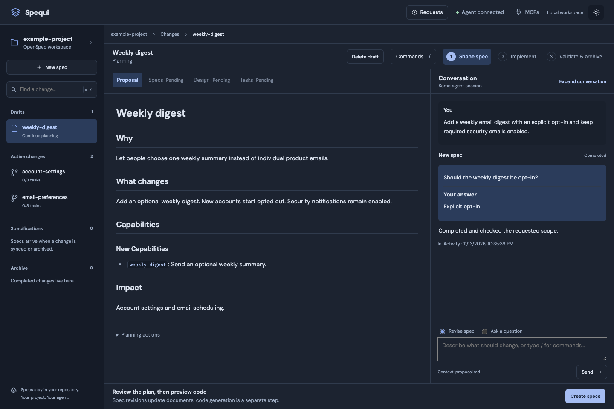
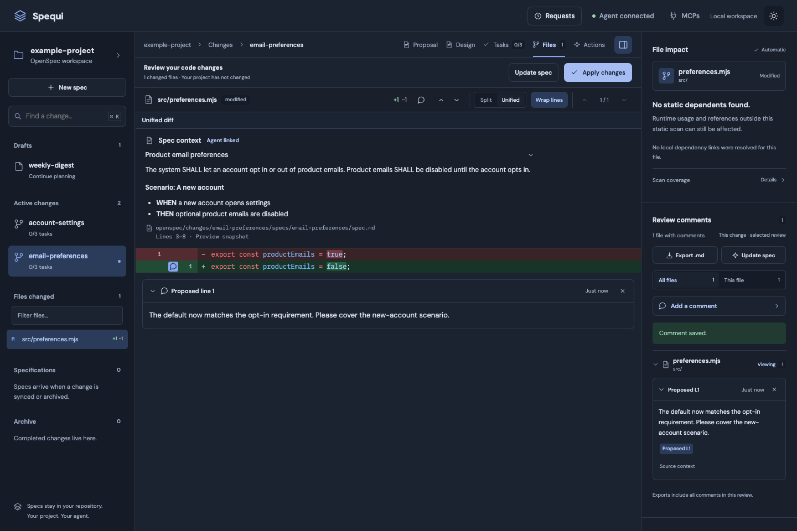

<div align="center">

# Spequi

**Plan with your agent. Review every change.**

A local workspace for planning, implementing, and reviewing [OpenSpec](https://openspec.dev/) changes with the coding agent you already use.

[](https://nodejs.org/)
[](LICENSE)
[](#stack)

[Get started](#get-started) · [Planning and review](#planning-and-review) · [Features](#features) · [How it works](#how-it-works) · [Agent setup](#attach-your-agent)

</div>

## Planning and review

Start with **New spec** to shape an idea with your agent. Ideas save automatically under **Drafts** in the left panel; return there to resume unfinished planning or delete a draft. Draft deletion can also remove its generated planning files after confirmation.

Select an existing change to read documents, inspect proposed code, and leave feedback. Its **Build** tab provides spec refinement, implementation preview, validation, and archive. New specs and existing changes use the same planning workspace, retained previews, and conversation. Applying reviewed files always requires explicit confirmation.

Open **Requests** in the header to inspect the queue and history, filter by status, cancel pending work, retry supported failed requests, or delete a finished request with its associated preview and review data. Active work stays visible while you browse another spec. Partially edited planning work must be reviewed before continuing.


_New spec: shape the plan beside your agent conversation and resume it from Drafts._


_Review: inspect a saved implementation and leave feedback. Screenshots use a local example project._

<details>
<summary>See planning and review in dark theme</summary>





</details>

## Features

|                              | What you can do                                                                                                                                                         |
| ---------------------------- | ----------------------------------------------------------------------------------------------------------------------------------------------------------------------- |
| **Run the lifecycle**        | Create and resume drafts, or open an existing change’s Build workspace to refine the spec, preview and apply code, then validate and archive. Answer agent questions in the app.                       |
| **Read the plan**            | Browse Proposal, Design, Tasks, active changes, archived changes, and specifications. Switch between rendered Markdown and source.                                      |
| **Review real code**         | Compare the current project with an agent's isolated implementation. Use highlighted Unified or Split diffs, changed-word emphasis, context folding, and line wrapping. |
| **Trace changes to the spec** | Read quoted requirements beside changed code blocks, with source lines from the preview’s saved plan. Agent links and suggested file context are labelled separately. |
| **Understand impact**        | Inspect direct and downstream dependencies, related tests, and export changes, with explicit static-analysis limitations.                                               |
| **Leave precise feedback**   | Add file notes or inline comments on code, Markdown passages, and source ranges. Keep the exact reviewed source context.                                                |
| **Refine the specification** | Export an immutable Markdown review brief or queue a planning update for your agent to reconcile with OpenSpec.                                                         |
| **Stay in your workflow**    | Use a local Node server and your current skill-capable agent. Switch between light and dark mode.                                                                       |

## Get started

Requires **Node.js 20+**, npm, and a target project containing OpenSpec files.

For agent-driven planning and implementation, also install the OpenSpec CLI and make the required OpenSpec workflow skills available to your coding agent, then attach it with the `spequi` skill. Initializing this package installs the UI skill and command wrappers; OpenSpec setup and its workflow skills are separate. Browsing, review, offline affected-file analysis, and patch import work without an attached agent.

The current OpenSpec CLI [requires Node.js 22.12+](https://github.com/Fission-AI/OpenSpec/blob/main/package.json), independently of this UI’s Node.js 20 minimum. Use Node.js 22.12+ for the complete setup with current OpenSpec.

### Initialize with npx

```sh
cd /path/to/your-project
npx spequi@latest init
```

Then invoke the registered viewer skill in your agent, or start the server directly:

```sh
node .spequi/server.mjs
```

A global installation is also supported:

```sh
npm install -g spequi
spequi init
spequi start
```

Automatic browser opening is not implemented; open the printed URL or use your agent's browser capabilities.

### Run from source

```sh
git clone https://github.com/rahulnjs/spequi.git
cd spequi
npm ci

node bin/spequi.mjs init --root "/path/to/your-project"
node bin/spequi.mjs start --root "/path/to/your-project"
```

Open the printed URL, normally **http://127.0.0.1:4310**. To choose another port, add `--port 4311` to the start command.

Point the viewer at your own project. This repository keeps its runtime source and README screenshots; it does not ship sample OpenSpec plans. An empty project shows setup guidance. Initialize OpenSpec separately when needed.

## Attach your agent

GigaCode uses monitored Shell calls with `is_background: true` for the server and five-minute `agent wait` calls. Waiting does not claim a job; the agent claims it in the foreground after receiving the result. Background completion must resume the host session for unattended idle attachment to work. The skill includes a check and a foreground fallback. Closing the coding agent pauses consumption and leaves requests saved.


The viewer uses **your existing coding agent**. It does not launch a model or require a separate provider API key.

| Agent                      | Invoke after initialization                                            |
| -------------------------- | ---------------------------------------------------------------------- |
| Claude Code                | `/spequi`; use `/spequi init` for setup                |
| Codex                      | `$spequi`, or select the viewer skill                                 |
| Sber/GitVerse GigaCode CLI | `/skills spequi` or `/spequi`                           |
| Other skill-capable agents | Load `.agents/skills/spequi/SKILL.md` using the tool's own convention |

Reload your agent if newly generated commands or skills do not appear. Command discovery and slash syntax depend on the agent.

The skill starts the local server and consumes queued requests. Without an attached agent, browsing, review, offline affected-file analysis, and patch import remain available. Agent implementation and planning requests wait in the queue; optional configured model generation can produce proposed edits directly.

The attached session also runs the installed skills selected by each job: `openspec-apply-change` for preview implementation, `openspec-propose` for proposals, `openspec-update-change` for feedback, and `openspec-archive-change` for archive requests. Exploration and verification use their corresponding installed workflows when available, with read-only fallbacks; impact reports run directly. The agent loads the selected skill in the same session, reports the result, and resumes polling. No second agent process or model connection is started for this handoff. Required missing workflows produce a failed job with an explanation; they are not installed automatically. Preview workflow edits and task updates stay in the isolated copy; viewer log/finish/fail commands run from the original project. Refresh an initialized project's skill with `node .spequi/cli.mjs skill install` to receive these routing instructions.

## How it works

1. **Initialize and attach.** Create project-local launchers and connect your existing coding agent with the `spequi` skill.
2. **Plan in Build.** Choose **New spec** to describe an idea, or open an existing change. Create the next planning artifact or a full plan; answer your agent's questions in the conversation.
3. **Preview in Build.** Open **Implement** and request a preview. Your agent works in a separate project copy; finishing freezes the proposed files for inspection.
4. **Inspect in Review.** Read Proposal, Design, and Tasks, then inspect Files with actual diffs, quoted spec context at linked change blocks, dependency impact, and inline comments.
5. **Refine.** Export feedback or select **Update spec** to request a planning revision from that exact snapshot. Generate a fresh preview when the plan changes.
6. **Apply and finish in Build.** Explicitly apply the reviewed preview, validate the spec, verify implementation with your agent, then sync or archive when ready.

Spec revisions and implementation previews are separate actions. Exporting feedback does not edit a specification or apply code. The underlying apply API checks retained hashes and baseline conflicts before writing reviewed files and keeping recoverable backups.

### Spec context in diffs

In both modes, linked change blocks show the requirement, scenario, or planning decision behind the edit. Each quote includes its source path and line range from the preview’s retained baseline. Collapse a quote to focus on code; repeated links point back to the first quote.

The attached agent records code-to-spec locations while implementing. Older previews and imported patches can show **Suggested · file-level** context when the saved plan mentions the file or a changed symbol. Suggestions need reviewer confirmation. Files without a supported match say so explicitly. Refresh an initialized project's skill with `node .spequi/cli.mjs skill install` to enable recorded links for new previews. See the [agent metadata format](docs/agent-workflow.md#spec-links-in-implementation-previews).

### What initialization creates

```text
your-project/
├── .spequi/
│   ├── config.json       # Port and initialized viewer version
│   ├── cli.mjs           # Project command launcher
│   ├── server.mjs        # Server launcher
│   ├── jobs/             # Queued agent requests
│   ├── previews/         # Isolated baseline and proposed files
│   └── backups/          # Recoverable applied-file backups
├── .agents/skills/spequi/SKILL.md
├── .claude/commands/spequi.md
└── .gigacode/
    ├── skills/spequi/SKILL.md
    └── commands/spequi.md
```

Feedback storage is created when needed. Initialization installs the `/spequi` command wrappers and adds `/.spequi/`, `/.agents/`, `/.claude/`, and `/.gigacode/` to the project's `.gitignore`. Existing ignore rules are preserved; files already tracked by Git remain tracked.

GigaCode registration follows its documented [skill discovery](https://gitverse.ru/docs/ai/ai-assistant-gigacode/gigacode-cli/skills) and [custom command format](https://gitverse.ru/docs/ai/ai-assistant-gigacode/gigacode-cli/commands), including `{{args}}` for command arguments. `init` and `skill install` register the project; `skill install --global` writes registrations under the user's home directory. Existing initialized projects can refresh with `node .spequi/cli.mjs skill install` when their initialized runtime includes this change. Registration is tested; continuous polling in a real GigaCode session has not yet been verified. Required OpenSpec workflows must be installed separately and discoverable by GigaCode.

Repeat initialization preserves Spequi configuration, comments, previews, application files, and custom launchers. An explicit reinitialization refreshes managed launchers and agent registration. If the original cached package disappears, the launcher can retrieve the initialized version through npm; registry access is needed for that recovery.

## Planning workflow

### Start a spec from an idea

Choose **New spec** in the left panel. Describe the idea and give it an unused lowercase change name. **Start with the next artifact** is the default; **Generate the full plan** requests all required planning artifacts. Continue queues one owned planning request for the attached agent. Its questions stay in the app, replies survive reloads, and the generated change opens in its draft planning workspace when the request completes. Partial plans offer the next schema-ready artifact; planning never automatically starts implementation.

The **Commands** picker in the planning workspace and slash commands use the same guarded operations. Supported commands are `/new`, `/explore <question>`, `/continue`, `/propose`, `/update <revision>`, `/apply`, `/status`, `/validate`, `/verify`, `/sync`, and `/archive`. `/opsx:<name>` and `/opsx-<name>` aliases also work inside the app. These are app commands, independent of the host's slash-command installation. `/apply` generates an isolated implementation preview; writing reviewed files still requires the separate Apply confirmation. Status and validation use the installed local OpenSpec CLI. Other commands wait for the existing agent session.

Planning versions are retained under `.spequi/studio/`. A revision stores exact Markdown before a planning request and after it completes; pending writes are not shown as completed revisions. The most recent 40 versions are retained, with at most 8 MiB of planning documents per version. This is local review evidence; the files under `openspec/` remain the source of truth.

New specs and unfinished drafts keep **Shape spec**, **Implement**, and **Validate & archive** in their header, with the plan beside its retained conversation. Select an existing change in the left panel for document and code review; open **Build** to refine it or run the remaining lifecycle steps. The project panel keeps the same layout in both flows.

In **Shape spec**, select a planning artifact tab and use **Revise spec** to request an update, or **Ask a question** for a read-only exploration. Changes appear as highlighted sections and a document summary. Capabilities with multiple documents show file tabs below their artifact tab. **Planning actions** offers the next artifact or full plan. Documents remain read-only.

In **Implement**, generate an isolated preview and choose its version. Browse changed files directly beneath the selected change in the left panel; filenames show their folder and edit counts, with no file search field. The **Files** button brings that list into view for the selected preview. Previous/next file controls, the selected file and diff tools stay above the independently scrolling code. Selecting a file keeps the same preview and planning workspace. Inspect the actual diff, then explicitly confirm **Apply reviewed preview**. A changed spec or source conflict prevents application. **Validate & archive** distinguishes local spec validation from agent implementation verification and exposes sync and archive with their normal prerequisites. Archive confirmations appear in the conversation. **New spec** starts the idea-to-plan flow; old lifecycle URLs redirect to the shared planning workspace.

Status, task readiness, and strict specification validation use the installed `openspec` CLI locally, with no agent required. Missing/incompatible CLI capabilities disable those actions with an explanation while documents and saved diffs remain readable. Spec validation checks requirements; checked task boxes alone do not prove implementation correctness. Setup and administration stay outside this UI.

Reasoning and writing requests use the current session running the viewer skill. Refresh the project skill after upgrading with `node .spequi/cli.mjs skill install`. Required workflows must already be installed; the viewer never launches another agent for a skill handoff. The agent uses `agent ask <id> --token <token> --message "question" [--options '["Yes","No"]']`, then `agent input <id> --token <token> --wait 300` until the app replies. The existing job resumes with the same ownership token; queued and awaiting-input requests can be cancelled. A running request can be ended only after its owning session’s heartbeat expires; stop the old agent in your coding tool first, since ending a request does not terminate its process or undo edits. Keep the agent session attached to continue waiting work.

Implementation previews still use isolated copies and apply only through an explicit, conflict-checked action. Offline affected-file analysis, optional model proposals, and patch import are available in the shared Implement stage; generated source remains reviewable in Files.

A saved preview becomes stale when its planning documents change. Generate a fresh preview before applying. Spec updates stay in the same page, with active questions and results shown in the main flow.

## Review workflow

Choose **Review — Inspect & comment** to examine a change through **Proposal**, **Design**, **Tasks**, and **Files**. Documents support rendered Markdown and source. Files compares the current and proposed versions with Unified or Split diffs, syntax highlighting, changed-word emphasis, folding, and wrapping. The inspector follows the selected file with dependency impact and saved comments.

Comment on a whole file, a code range, or a passage in Proposal or Design. Notes retain the exact reviewed version. **Export MD** downloads a feedback brief; **Update spec** queues a planning revision for the attached agent. Return to Build to continue the conversation, generate a new implementation preview, or apply reviewed code.

## Agent-free analysis and previews

Under **Build → Implement → Offline analysis and preview tools**, **Analyze affected files** matches the selected change's planning documents to current source without an agent or network. It explains explicit paths, named symbols, related text, and local dependencies separately from actual changed files. Analysis scans at most 1,000 text files, 512 KB per file, and 8 MiB of source; planning documents are limited to 2 MiB total. Exclusions, skipped files, unresolved references, and stale inputs are disclosed. Dynamic references, aliases, external packages, and dependencies outside supported JS/TS, CSS, and HTML forms can be missed.

**Import patch** stages a unified patch in a separate project copy without an agent. Patches can add, modify, and delete up to 30 eligible UTF-8 files, within a 1 MiB patch/proposed-content limit. Renames are represented as deletion and addition. Review the saved diff, export it, add comments, or explicitly apply it using the existing baseline conflict checks. A failed import does not publish a partially completed preview.

For optional generation without an agent session, add `previewModel` to `.spequi/config.json` while preserving its other settings:

```json
{
  "version": 1,
  "port": 4310,
  "previewModel": {
    "endpoint": "http://127.0.0.1:11434/v1/chat/completions",
    "model": "your-installed-model",
    "timeoutMs": 120000
  }
}
```

The endpoint must accept Chat Completions-compatible JSON and return text at `choices[0].message.content`; a compatible local runtime can keep generation offline. No model is installed or downloaded by the viewer. Hosted endpoints require HTTPS; plain HTTP is accepted only for loopback hosts. If authentication is required, set `"apiKeyEnv": "SPEQUI_PREVIEW_API_KEY"` and supply that environment variable to the viewer process. Credentials stay server-side; do not put an API key in the endpoint URL.

Analyze first, select between 1 and 12 candidate files, and choose **Generate with model**. This action sends the change's planning documents and the selected files to the displayed destination. It sends no other source context. The combined input is limited to 256 KB; output is limited to 30 edits and 1 MiB of proposed source. Stale analyses require a new scan. Existing files outside the selected context, secrets, planning artifacts, agent configuration, and escaping paths cannot be edited. Eligible new source files can be added. The model returns file contents only: the viewer runs no tools, shell commands, installations, or implementation tests. Generated and imported previews show their origin and unrun-check status; review and test before applying.

All UI styles, scripts (including HTMX), and fonts are served by the local viewer. DM Sans and IBM Plex Mono are bundled with their licenses, so the installed UI needs no CDN or internet access. Installation and package recovery through npm still require registry access unless the packages are already available locally.

## Stack

**Node.js ES modules · server-rendered HTML · HTMX · WebSockets · plain CSS and JavaScript**

No frontend compilation or hosted backend. Runtime dependencies handle watching, Markdown sanitization, syntax highlighting, diffs, and WebSocket transport.

```text
bin/          Executable CLI
src/          Server, project reader, previews, impact, and review implementation
public/       Runtime styles and browser JavaScript
skills/       Maintained portable agent skill
templates/    Self-contained project launcher template
docs/         README screenshots; excluded from the npm package
```

## Local data and boundaries

- The server binds to `127.0.0.1`; mutations require local Host/Origin checks and a session token.
- `.spequi/` contains local configuration, requests, previews, feedback, and backups. Keep it out of Git.
- Browsing and offline analysis do not upload project source. Explicit model generation sends the planning documents and selected source to the configured endpoint. Your attached agent retains its own provider and permission settings.
- A preview copy is not an OS security sandbox. The agent must honor its assigned working directory.
- Static impact evidence does not establish complete runtime behavior, dynamic references, aliases, or external-package effects. Scan limitations remain visible.
- LF and CRLF comparisons use normalized display lines; retained hashes, patches, and application preserve the exact reviewed bytes. Native Windows execution remains a release verification item.

## Development and packaging

```sh
npm ci
npm run check
npm pack --dry-run
npm publish --dry-run
```

There is no build step. `package.json.files` limits the npm archive to runtime code/assets, the portable skill, launcher template, package metadata, README, and license. Screenshots and local development/sample data are excluded. Publication runs syntax checks first.

## Naming and project data

The app is **Spequi**. Its npm package, shell command, and agent skill are **spequi**: use `$spequi` in Codex, or `/spequi` in tools that support those command wrappers. Reload your agent after registration if it has not discovered the new skill.

Initialization creates `.spequi/` for local configuration, queued jobs, previews, comments, and backups. Run `spequi init` to refresh managed launchers and skill registrations; custom launchers are preserved. The agent command is `/spequi`.

Spequi starts fresh in `.spequi/`. Initialization does not import, move, rename, or delete data from earlier tools.

## Agent liveness and MCP reports

For the code-level attachment, skill routing, question and completion flow, see [How the agent workflow works](docs/agent-workflow.md).

The header's agent indicator reflects a recent agent heartbeat, independently of the browser connection to the local server. It distinguishes live, working, awaiting an answer, not responding, and unattached. Connection details show the last heartbeat and MCP metadata reported by the current session. **Reconnect agent** opens instructions to resume the spequi skill in the same coding session, with a **Check connection** action. Requests and answers stay saved; the viewer does not restart an agent automatically.

The agent can write a credential-free report under `.spequi`, then run:

```sh
node .spequi/cli.mjs agent report --file .spequi/session-report.json --name "Skill agent"
```

For example, when the host provides authoritative connection status:

```json
{
  "sessionId": "a-stable-random-id-for-this-attachment",
  "mcps": {
    "supported": true,
    "connections": [{ "name": "Filesystem", "status": "connected" }]
  }
}
```

Allowed MCP statuses are `connected`, `disconnected`, `unavailable`, and `unknown`. Only display names and statuses are accepted; omit credentials, server URLs, environment variables and transport configuration. When the agent host cannot enumerate connection status, report `{"mcps":{"supported":false,"connections":[]}}` instead. A tool catalog or configured server alone is insufficient evidence of a healthy connection. Retain the returned session ID for report refreshes, pass it as `agent next --session-id <id>` and use the same agent name when polling, and refresh at least every five minutes or when connections change. Missing, expired and disconnected-session reports display unknown rather than a fabricated count. Reporting does not replace serving the agent queue.

The header uses **MCPs** when the current session has not supplied connection evidence; the details explain why. **0 MCPs** is shown only when a fresh supported report confirms zero connections. Build keeps the current conversation and document independently scrollable, compacts the composer and action footer, shows current progress without expanding Activity, and collapses older completed exchanges. New documents use normal prose; changed-section highlights begin with revisions to existing text.

## License

[MIT](LICENSE)
