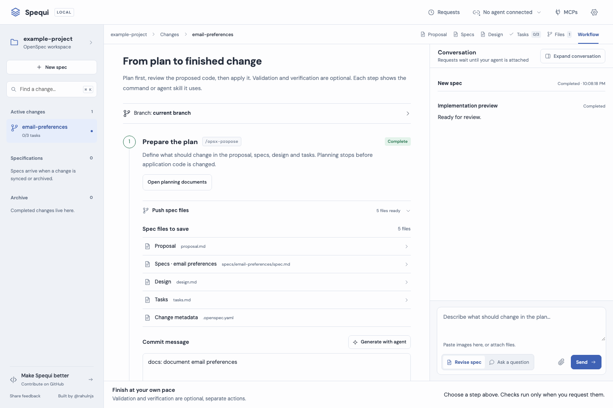

# Workspace screenshots

Nine documentation images are retained: the README uses the light planning/review pair; the public landing page embeds those views in both themes. Workflow and Settings examples below have linked dark versions. The Git form has one light capture. Other preview captures are not retained.

| Workflow | Settings |
| --- | --- |
|  |  |

[Build: spec file review and push](build-ready-light.png).

Dark versions: [Workflow](workflow-dark.png), [Settings](settings-dark.png), [planning](build-dark.png), [file review](file-review-dark.png).

Regenerate from the repository root with Node and installed Google Chrome:

```bash
node docs/screenshots/capture.mjs
```

An optional first argument selects another Chrome executable. The script launches headless Chrome with a disposable profile and a temporary example OpenSpec project. It creates local fixture plans, comments and a frozen preview, captures the UI at 1440 × 960, and refreshes the landing page’s embedded images. It does not edit the real project’s runtime data, execute an agent, commit, or push. The fixture uses saved readiness data to show completed planning artifacts without requiring an OpenSpec CLI installation. Temporary project, server and browser processes are cleaned up when capture finishes.
